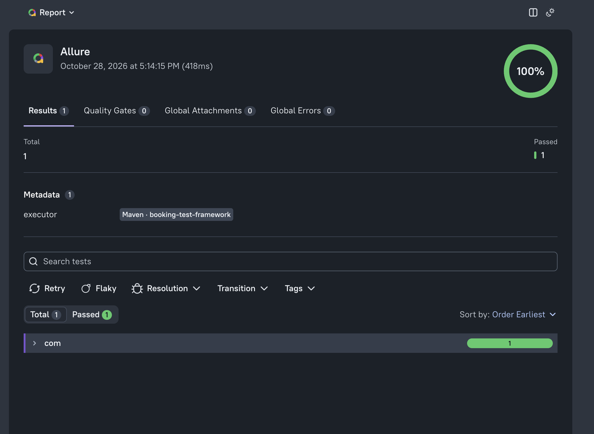

# booking-test-framework

Java test automation framework for a containerized courier shift booking system
(system under test: https://github.com/uekita/fullstack-booking-system).

One framework, two layers: REST Assured against the API and Playwright against the UI,
run by JUnit 5 in parallel, reported by Allure, logged through SLF4J. Built for a Senior
Quality Engineer technical exercise, with AI assistance under a human-in-the-loop workflow
(see below).

**At a glance:** 49 tests green by default (40 API, 9 UI) · 13 known bugs found, each written
up in [`documents/BUGS.md`](documents/BUGS.md) and replayable as a red-by-design test.
Booking reschedule tests target application PR #1 (`feature/booking-reschedule`, commit `8a5ab94`).

## How to use

### 1. Prerequisites

| Tool | Version | Check |
|---|---|---|
| JDK | 21 or newer (project compiles with `release 21`) | `java -version` |
| Maven | 3.9 or newer | `mvn -v` |
| Docker Desktop | Compose v2 or newer | `docker compose version` |
| Free ports | 3000 (UI), 8080 (API), 5432 (Postgres) | — |

### 2. Start the application under test

In a folder of its own, not inside this project:

```
git clone https://github.com/uekita/fullstack-booking-system
cd fullstack-booking-system
docker compose up --build -d
```

The first build takes a few minutes. Verify:

```
curl localhost:8080/actuator/health
```

Expected: `{"status":"UP"}`. UI at http://localhost:3000, Swagger at
http://localhost:8080/swagger-ui.html.

To reset the application to its seed state: `docker compose down -v && docker compose up -d`.
Not required between runs: tests never depend on existing data.

### 3. Browser

Playwright downloads Chromium on the first UI run by itself (the first run is slower; Surefire
may print a harmless "Corrupted channel" warning while the download progress is written).
If that download is blocked, install it explicitly:

```
mvn exec:java -e -D exec.mainClass=com.microsoft.playwright.CLI -D exec.args="install chromium"
```

### 4. Run the tests

Full suite (API + UI, headless, parallel; known-bug tests excluded):

```
mvn clean test
```

Subsets:

| Goal | Command |
|---|---|
| API tests only | `mvn test -Dgroups=api` |
| UI tests only | `mvn test -Dgroups=ui` |
| Smoke subset | `mvn test -Dgroups=smoke` |
| One class | `mvn test -Dtest=BookShiftE2ETest` |
| Watch the browser | `mvn test -Dgroups=ui -Dui.headless=false` |
| **Known bugs only (expected red)** | `mvn test -Dgroups=bugs -DexcludedGroups=` |
| Everything, bugs included | `mvn test -DexcludedGroups=` |
| Sequential (debugging) | `mvn test -Djunit.jupiter.execution.parallel.enabled=false` |
| Other environment | `mvn test -Denv=ci` or `-Dapi.base.url=... -Dui.base.url=...` |
| Rerun failures once | `mvn test -Dsurefire.rerunFailingTestsCount=1` |

Known-bug tests are excluded by default through the `excludedGroups` property in `pom.xml`;
`-DexcludedGroups=` (empty) lifts the exclusion.

### 5. Generate and view the report

Interactive (builds the report from `target/allure-results` and opens it in the browser):

```
mvn allure:serve
```

The report is a snapshot of the results present when it starts: after a new test run, run
`allure:serve` again. `mvn clean` wipes the previous results.

Static report, for CI artifacts or sharing:

```
mvn allure:report
```

Output: `target/site/allure-maven-plugin/index.html`. The report shows each test as named
steps, every API request and response, and for a failed UI test a full-page screenshot and
the Playwright trace. The trace is also kept in `target/traces/`; open it at
https://trace.playwright.dev or with
`mvn exec:java -e -D exec.mainClass=com.microsoft.playwright.CLI -D exec.args="show-trace <file>"`.



### 6. Logs

Console during the run, and `target/logs/tests.log` after it. Every HTTP call is logged on
the `http` logger with method, URL, status and time (`<-- 201 POST http://… (12 ms)`);
bodies at DEBUG level; headers are never logged.

## Requirements map

| Exercise requirement | Where |
|---|---|
| Maven project, JUnit 5 runner | `pom.xml`, `src/test/resources/junit-platform.properties` |
| Separation of concerns: page objects, API clients, config, test data, utilities | `src/main/java/com/booking/tests/{ui/pages, ui/components, api/client, config, data, util}` |
| UI journeys (1–2) with explicit waits, robust locators, no hardcoded data | `BookShiftE2ETest`, `BookShiftNegativeE2ETest`; locators and waits in `ui/pages` and `ui/components`; data from `data/` builders |
| API tests (1–2 endpoints): status, response time, JSON structure and data | `CreateBookingApiTest`, `CancelBookingApiTest`, `CreateShiftApiTest`; `ResponseSpecification` with time ceiling; `schemas/booking.schema.json` |
| Request / response specifications | `api/spec/Specs` |
| POJO (de)serialization | `api/model/` records via Jackson |
| Reporting | Allure: steps, attachments, HTTP exchanges, screenshot + trace on failure — `mvn allure:serve` |
| Logging | SLF4J + Logback, `api/spec/Slf4jLogFilter`, `src/test/resources/logback.xml` |
| Test-data management and test independence | every test creates its own courier and shift via API; builders guarantee unique, non-overlapping defaults |
| Bugs and inconsistencies (application README, task 5) | [`documents/BUGS.md`](documents/BUGS.md), each bug covered by a `bugs`-tagged test |

## What is covered

**API** — `src/test/java/com/booking/tests/api/` (40 tests)

| Class | Covers |
|---|---|
| `MetaApiTest` | `GET /meta`: zones and vehicle types match the framework's enums; response-time ceiling (smoke) |
| `CreateBookingApiTest` | Happy path: 201, JSON schema, every echoed field, slot taken. Rule matrix (`@EnumSource`) in the server's precedence order: 404 courier, 404 shift, 409 inactive, 409 started, 409 duplicate, 409 overlap, 409 full, 400 nulls with `fieldErrors`. Back-to-back shift allowed; re-book after cancel allowed |
| `CancelBookingApiTest` | Cancel → 200 CANCELLED with `cancelledAt`, schema; second cancel → 409; slot freed (`availableSlots` back up) |
| `CreateShiftApiTest` | Both sides of every limit: duration 59 min / 1 h / 12 h / 12 h 01 min, capacity 0 / 1 / 50 / 51, end == start, start in the past |
| `RescheduleBookingApiTest` | Reschedule (PR #1): 200 with the same id and `createdAt`, target data echoed, old slot freed, new slot taken, no new row, schema. Rule matrix in the PR's order: 404 booking, 404 shift, 409 cancelled, same shift, inactive, started, overlap with another booking, full, 400 null `shiftId`. Back-to-back target allowed; moving back to a capacity-1 original reuses the freed slot |
| `BookingConcurrencyTest` | Capacity-1 shift, 10 couriers booking at the same instant → exactly one 201, nine 409 "Shift is full". Same for 10 parallel reschedules into one capacity-1 shift (losers stay on their shift); one booking rescheduled to two shifts at once ends on exactly one, counts consistent |

**UI** — `src/test/java/com/booking/tests/ui/` (9 tests)

| Class | Covers |
|---|---|
| `ShiftsSmokeTest` | Page loads; a shift seeded through the API is rendered with zone, `0 / N`, OPEN badge (smoke) |
| `BookShiftE2ETest` | Critical journey: book a shift in the UI → success toast → `1 / 2` → API shows exactly one CONFIRMED booking → Bookings tab lists it (smoke) |
| `BookShiftNegativeE2ETest` | Overlapping booking rejected: API reason shown in the error toast, dialog stays open, nothing stored |
| `RescheduleBookingE2ETest` | Reschedule through the searchable picker → "Booking rescheduled" → row shows new shift and zone → API: same booking moved, no new row. Overlap with another booking rejected: error toast, dialog open, booking not moved |
| `ReschedulePickerUiTest` | Reschedule enabled for confirmed, disabled for cancelled; picker leaves out the current shift, shows a full shift disabled and not selectable; ArrowDown + Enter selects, Escape closes the list but not the dialog |

**Known bugs** — 13 tests tagged `bugs`, excluded by default (see below).

Every test was seen failing for the right reason once (mutation check) before it counted.

## Bug reports

Thirteen bugs: BUG-01…10 confirmed by a failing test on 2026-10-28, BUG-11…13 (reschedule,
PR #1) reproduced on 2026-10-29. Full reports — steps, expected vs
actual, root cause in the application source, suggested fix — in
[`documents/BUGS.md`](documents/BUGS.md).

| ID | Bug | Severity |
|---|---|---|
| BUG-01 | Parallel requests let one courier book overlapping shifts (race; 5/5 reproduced) | High |
| BUG-02 | Courier name of 1 character accepted (length checked before trim) | Low |
| BUG-03 | Phone with 1 digit accepted (separators count as digits) | Medium |
| BUG-04 | Unsupported Content-Type returns 500 instead of 415 | Low |
| BUG-05 | Deactivated courier keeps confirmed future bookings | Medium |
| BUG-06 | UI edit of a booked shift fails with 409 although only capacity changed | Medium |
| BUG-07 | Shifts in progress disappear from the default Shifts view | Medium |
| BUG-08 | Unknown courier: 404 on one bookings endpoint, 200 `[]` on the other | Low |
| BUG-09 | `createdAt` in create responses differs from the stored value | Low |
| BUG-10 | Invalid enum in a request body is not reported as a field error | Low |
| BUG-11 | Reschedule rejected as "overlap" when the target overlaps only the booking being moved | Medium |
| BUG-12 | Parallel reschedules let one courier end up with overlapping bookings (race, same cause as BUG-01) | High |
| BUG-13 | API reschedules a booking whose shift has already started | Medium |

**How bugs are handled.** Each bug has a test that asserts the *correct* behaviour, so it is
**red by design** while the bug exists and turns green when it is fixed — a fix is verified by
the suite, not by memory. They are excluded from the default run so the regular suite stays a
clean signal; `mvn test -Dgroups=bugs -DexcludedGroups=` replays all thirteen. Where the
application README states a rule, that is the expected behaviour; where it does not, the
expectation is ours, written down in the report as an assumption with its reasoning (a product
decision to confirm, not a hidden opinion).

## Project structure

```
src/main/java/com/booking/tests/      framework library
  config/        Config interface + PropertiesConfig (-D > env var > env file > defaults)
  api/spec/      Specs (RequestSpec / ResponseSpec), Slf4jLogFilter
  api/client/    one client per resource: CourierClient, ShiftClient, BookingClient
  api/model/     records: Courier, Shift, Booking, *Request, ApiError; enums Zone, VehicleType
  data/          CourierBuilder, ShiftBuilder: valid, unique defaults; tests override only what they assert
  ui/driver/     PlaywrightManager (one browser per thread, context + page per test),
                 UiTestExtension (screenshot + trace attached on failure)
  ui/pages/      page objects: ShiftsPage, BookingsPage — locators and actions, no assertions
  ui/components/ NavTabs, BookDialog, ShiftDialog, Toast — reused across pages
  util/          Waits (fluent polling for non-DOM conditions), Json (shared ObjectMapper)
src/main/resources/config/            defaults.properties (+ per-environment files)
src/test/java/com/booking/tests/      tests only
  api/           API tests, BookingConcurrencyTest, KnownBugsApiTest
  ui/            UI journeys, KnownBugsUiTest
src/test/resources/                   junit-platform.properties, allure.properties,
                                      logback.xml, schemas/
documents/                            BUGS.md, briefing, tool reference, presentation notes
```

Framework code lives in `src/main` because it is a library: compiled on its own
classpath, reusable by other suites, and the tests under `src/test` read as plain
business cases.

## Design principles

- Every test creates its own data through the API (unique courier, far-future shift);
  nothing depends on seed rows or on another test. Tests run in parallel by default.
- Builders make the safe thing the default: each default shift gets its own calendar day, so
  two shifts overlap only when a test asks for it (`overlapping(...)`, `backToBack(...)`).
- Page objects return the next page or component; a test reads as the user journey.
- Three tiers of waiting: Playwright auto-wait for actions, explicit `waitFor` /
  `waitForResponse` for semantic state (dialog open, list fetched, booking answered), a small
  fluent poller for cross-layer conditions (shift reported IN_PROGRESS). No `Thread.sleep`.
- Locators: `id` first, then `data-*` / role, then `tr[data-id]`; positional `td:nth-child`
  only for cell assertions; never XPath. Every locator was checked against the live DOM.
- Assertions live in tests, never in page objects or clients. Client `*Ok` helpers only
  guard test setup.
- Every HTTP call is logged and attached to the report.
- Known bugs are tests, not notes.
- Secrets never enter the repository or the logs.

## Choosing the tooling

| Choice | Picked | Over | Why |
|---|---|---|---|
| Build | Maven | Gradle | The exercise and the application itself are Maven; `mvn clean test` is what a reviewer will type. |
| Runner | JUnit 5 (Jupiter 6.x, same API) | TestNG | Default of the Spring Boot ecosystem; the extension model gives screenshot and trace on failure in one small class; parallel execution is a properties file, no plugin; tags drive suite selection. |
| UI | Playwright for Java | Selenium | Auto-waiting on actionability removes most explicit-wait boilerplate; the trace viewer shows DOM, network and console at the failing step; browsers are bundled. Explicit waits are kept where the condition has business meaning. |
| API | REST Assured + JSON-schema validator | plain HttpClient | Request/response specifications hold base URL, headers, logging and the response-time ceiling in one place; schema validation pins the response shape. |
| JSON | Java records + Jackson | Lombok | Immutable DTOs with zero annotation processing; nothing to install in an IDE. |
| Reporting | Allure 3 | ExtentReports | Steps, screenshots, traces and every HTTP exchange in one report; history across runs. |
| Logging | SLF4J + Logback | Log4j2 | Standard API; one `logback.xml`; a REST Assured filter logs each call, never its headers. |
| Config | Hand-rolled `Config` interface | Owner / Typesafe Config | One small class; precedence is `-D` property, then environment variable, then `config/<env>.properties`, then defaults; fails fast on a missing or malformed key. No unmaintained dependency. |
| Java | 21 | 25 | Matches the application and every library baseline; a one-property change later. |

## Tech stack

| Tool | Version |
|---|---|
| Java | 21 (release target; built with Temurin 25) |
| Maven / Surefire | 3.9+ / 3.6.1 |
| JUnit Jupiter | 6.1.3 |
| Playwright for Java | 1.64.0 |
| REST Assured + json-schema-validator | 6.3.0 |
| Jackson (databind, jsr310) | 2.22.4 |
| Allure (jupiter, rest-assured) / allure-maven | 3.0.1 / 3.1.0 |
| SLF4J / Logback | 2.0.20 / 1.6.6 |

## Human in the loop

This project was built with Claude Code as a pair, under rules committed to the
repository in `CLAUDE.md`:

- AI drafts, I decide. Every change is proposed as a short plan first, implemented only
  after approval, and every diff is reviewed before it is accepted.
- No AI commits. I run the tests and make every commit by hand, one per build step; the
  history is mine.
- A test counts only after I have seen it fail for the right reason. Each test was mutated
  once (expected status or text flipped, rule broken) to confirm it catches what it claims to
  catch; known-bug tests count when their red run fails with the predicted message.
- The model used the Playwright MCP server (`.mcp.json`) to read the live DOM before
  proposing any locator, and read the application source to ground expected messages and
  bug root causes.
- Deviations from the initial spec are recorded with their reasons in
  `documents/BRIEFING.md` (for example: no assertions in the `Toast` component; no tab click
  when opening the Shifts page, because it triggers a second fetch that re-renders the table),
  and the documents there are re-checked after every build step.

The intent: reproducible, reviewable AI assistance, with accountability resting on the
engineer.

## Configuration

`src/main/resources/config/defaults.properties`:

| Key | Default | Meaning |
|---|---|---|
| `ui.base.url` | `http://localhost:3000` | UI entry point |
| `api.base.url` | `http://localhost:8080/api` | API base path |
| `ui.browser` | `chromium` | `chromium`, `firefox` or `webkit` |
| `ui.headless` | `true` | headless browser |
| `api.max.response.ms` | `2000` | response-time ceiling enforced by the response spec |

Precedence: `-Dkey=value` > environment variable (`UI_BASE_URL`, ...) >
`config/<env>.properties` (via `-Denv=<name>`) > `defaults.properties`.

## Extending the framework

| Task | Steps |
|---|---|
| New page | add a class in `ui/pages` extending `BasePage`; locators by id/role; actions return the next page; no assertions |
| New endpoint | add a method to the resource's client in `api/client` using `Specs.request()`; add a record to `api/model` if the payload is new |
| New test | extend `BaseApiTest` or `BaseUiTest`; build data with `data/` builders; tag it `smoke` if it belongs to the quick check |
| Negative case | call the client's raw method, assert `Specs.status(409)` and `ApiError.message()` |
| Data-driven case | `@ParameterizedTest` with `@CsvSource` / `@EnumSource` / `@MethodSource` over a builder override |
| New bug | add a test asserting the correct behaviour, tag it `bugs`, see it fail, write it up in `documents/BUGS.md` |
| Another environment | add `config/<name>.properties`, run with `-Denv=<name>` |

## Assumptions and known issues

- The application has no authentication, so the exercise's "login → booking" journey is
  implemented as "seed via API → book a shift in the UI → verify in Bookings and via API".
  An auth seam exists in the request specification (`API_TOKEN`) for when a token appears.
- The UI exposes stable `id`s and `data-*` attributes but no `data-testid`.
- The database only grows (bookings cannot be deleted); tests create far-future data
  (2030 onwards) and never rely on seed rows, which age out.
- The success toast auto-hides after four seconds and is asserted immediately after the
  action.
- The response-time ceiling (2000 ms) is sized for Docker on a laptop; it is an SLA hook,
  not a benchmark. It is not applied to the deliberately concurrent requests.
- "Already started" cases need a started shift, which the API refuses to create; the test
  creates one a few seconds ahead and polls until the server reports IN_PROGRESS. This
  assumes the test host and the application share a clock (both local).
- BUG-01 is a race: its test fires five requests at the same instant and reproduced the bug
  5/5, but a lucky run could pass. BUG-12 is the same race on the reschedule path.
- The reschedule tests (`RescheduleBookingApiTest`, the reschedule cases of
  `BookingConcurrencyTest`, `RescheduleBookingE2ETest`, `ReschedulePickerUiTest`, BUG-11…13)
  need the application on PR #1 (`git checkout feature/booking-reschedule && docker compose up --build -d`);
  against `main` the endpoint does not exist and they fail with 404.
- The reschedule picker lists every upcoming shift in the database, so UI tests address
  options by shift id and never by position.
- Known-bug tests are red by design and excluded from the default run.

## Further work

**Scale-up**
- CI pipeline: Compose up with health wait, `mvn test`, Allure report as artifact,
  application logs on failure; a separate non-blocking job for the `bugs` group.
- Testcontainers to start the application from the suite itself.
- Allure history and trends; quarantine tag with a ticket for known-flaky tests.
- Contract layer: validate responses against the application's OpenAPI document
  (`/v3/api-docs`); consumer-driven contracts when front end and back end deploy
  independently.
- Load test on `POST /bookings` with k6; event assertions once booking events are
  published.
- Ask the application team for `data-testid` attributes.

**Deep AI integration**
- Test candidates generated from the OpenAPI document and the running application,
  human-verified before they count.
- Exploratory API probing through MCP feeding the bug log.
- Flaky-test triage assisted by the model over Allure history.
- AI review gate on pull requests under the same human-in-the-loop rules.
- LLM-as-judge evaluations with golden sets if the application gains an AI feature.

**Coverage**
- Cancel-booking journey in the UI, courier management journey, shift edit guard rails.
- Visual regression of the shifts table.

## License

MIT — see `LICENSE`.
